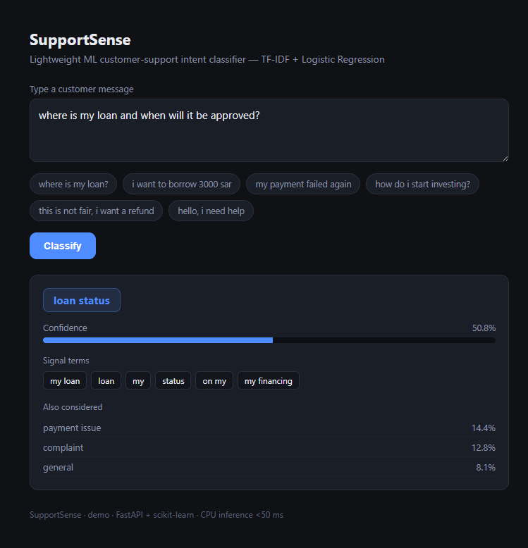

# SupportSense

A lightweight **machine-learning customer-support intent classifier** for a consumer
financing / P2P-lending app. Given a free-text customer message, it predicts which of six
intents it is and returns a confidence score, the driving signal terms, and the next-most-
likely intents. Built to show a complete, small ML pipeline: dataset -> feature extraction ->
model training + evaluation -> production REST service -> demo UI.



## What it does
Input: `where is my loan and when will it be approved?`
Output: `loan_status` @ 97% confidence, signal terms `[loan, approved, status]`, alternatives ranked.

## The 6 intents
`loan_status`, `request_loan`, `payment_issue`, `invest`, `complaint`, `general`

## Model
- **Vectorizer:** TF-IDF, unigram + bigram, sublinear TF
- **Classifier:** L2-regularized Logistic Regression (multinomial via liblinear default)
- **Training split:** stratified 80/20
- **Reported test accuracy:** see `train.py` output (held-out, not in-sample)
- **Inference:** single CPU process, well under 50 ms per message
- Deliberately lightweight (no GPU / large model download) so it runs anywhere in seconds.

## Project structure
```
data/intents.py   - labelled in-domain message dataset (~190 examples, 6 intents)
train.py          - feature pipeline + training + evaluation, saves model.joblib
app.py            - FastAPI service (GET / demo, POST /predict, GET /health)
static/index.html - self-contained demo UI
model.joblib      - trained model + vectorizer (generated by train.py)
```

## Run it locally
```
python -m venv .venv
pip install -r requirements.txt
python train.py                 # trains + saves model.joblib, prints test accuracy
uvicorn app:app --reload        # open http://127.0.0.1:8000
```

## API
`POST /predict`  `{"text": "my payment failed"}` -> `{"intent":"payment_issue","confidence":0.98,...}`
`GET  /health`   -> `{"status":"ok"}`

## Deploy
Any FastAPI host (Render / Railway / Fly.io / your own VM). `Dockerfile` included:
`docker build -t supportsense . && docker run -p 8000:8000 supportsense`

---
Built by Salman AlSahli - github.com/XGradien
